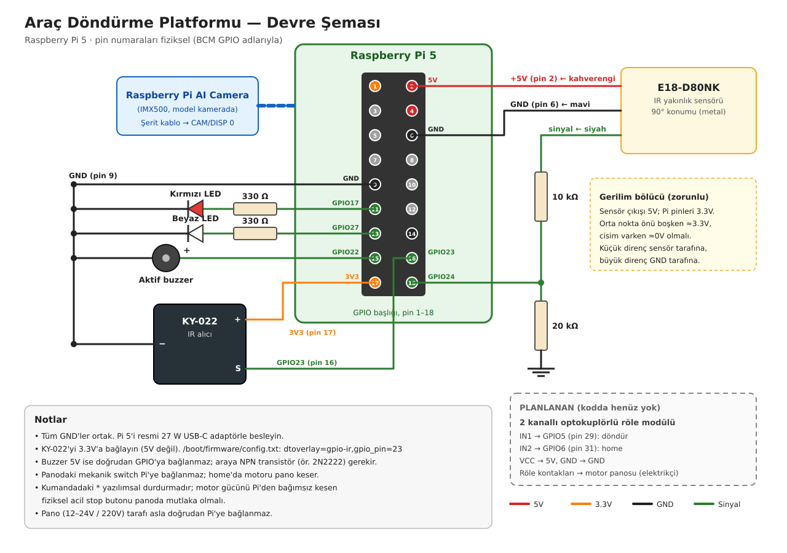

# Araç Döndürme Platformu — Basit Sürüm

Raspberry Pi 5 + Raspberry Pi AI Camera (IMX500) ile garaj girişindeki araç döndürme platformunun kontrolü. Nesne tespiti kameranın kendi çipinde çalışan COCO modeliyle yapılır; sadece `car`, `person`, `cat`, `dog` etiketleri dikkate alınır.

## Kullanım döngüsü
Tek kapı güneyde, garaj odası doğuda. Platform her seferinde **saat yönünün tersine 90°** döner ve iş bitince **saat yönünde** home'a geri gelir.

- **Giriş:** Araç kapıdan platforma önüyle girer → OK → platform döner → araç geri geri garaj odasına girer.
- **Çıkış:** Araç garaj odasından platforma önüyle çıkar → OK → platform döner → araç önüyle kapıdan çıkar.
- **Home:** Platform home'da değilken kamerada `auto_home_seconds` (10 sn) boyunca hiç araç görünmezse platform home'a döner. O an çevrede canlı varsa, canlı uzaklaşınca döner.

## Güvenlik kuralları
- **Döndürme şartı:** Araç kutusu **yuvarlak** güvenli bölgenin **tamamen içinde** olmalı ve çevrede canlı (insan, kedi, köpek) olmamalı. Araç kutusunun içinde kalan canlılar araç içi sayılıp yok sayılır.
- **Hareket sırasında:** Canlı görülürse motor hemen durur. Araç konumu kontrol edilmez, çünkü dönen aracın kutusu daireden taşabilir.
- **Acil durdur (kumandada `*`):** Motor durur ve sistem **kilitlenir**. `#` ile sıfırlanana kadar döndürme ve otomatik home çalışmaz.
- **Zaman aşımı:** Bir hareket `motion_timeout_seconds` (20 sn) içinde hedefe varmazsa (sensör arızası, sıkışma) sistem aynı şekilde kilitlenir.
- **Fiziksel acil stop:** Kumandadaki `*` yazılımsal bir durdurmadır. Motor gücünü Pi'den bağımsız kesen fiziksel acil stop butonu panoda mutlaka olmalıdır.

| Durum | Kırmızı LED | Beyaz LED | Buzzer |
|---|---|---|---|
| Duruyor | Açık | Kapalı | Sessiz |
| Dönüyor / home'a dönüyor | Kapalı | Açık | Kesikli |
| Acil durduruldu | Hızlı yanıp söner | Kapalı | Sürekli |

## Konum algılama
- **90° konumu:** E18-D80NK kızılötesi yakınlık sensörü platform ucundaki metali görür. Algılama mesafesi sensörün arkasındaki vidayla ayarlanır.
- **Home:** Motoru panodaki mekanik switch keser. Pi switch'i okumaz; home komutundan `home_seconds` sonra home'a varılmış kabul eder.
- **Ara konum:** Bilinmez ve gerekmez. Yön her zaman belli (dışarı = saat yönünün tersi, home = saat yönü); motor hedefe varana kadar döner.

Sensör bağlanmamışken sistem tam simülasyonda çalışır (90°'ye `rotation_seconds` sonra varılır). Sensörü açmak için: `config.py` → `MotorConfig.use_position_sensor = True`.

## Devre şeması


| Bileşen | Bağlantı (fiziksel pin) |
|---|---|
| Kırmızı LED | GPIO17 (11) → 330 Ω → LED → GND |
| Beyaz LED | GPIO27 (13) → 330 Ω → LED → GND |
| Aktif buzzer | GPIO22 (15) → buzzer + ; buzzer − → GND |
| KY-022 IR alıcı | `S` → GPIO23 (16), `+` → 3.3V (17), `−` → GND |
| E18-D80NK | kahverengi → 5V (2), mavi → GND (6), siyah → **10 kΩ** → GPIO24 (18); GPIO24 → **20 kΩ** → GND |
| AI Camera | Şerit kablo → CAM/DISP 0 |
| Röle modülü *(planlanan, kodda yok)* | IN1 → GPIO5 (29) döndür, IN2 → GPIO6 (31) home |

- **Gerilim bölücü zorunlu:** E18-D80NK çıkışı 5V, Pi pinleri ise 3.3V. Bölücünün orta noktası önü boşken ≈3.3V, cisim varken ≈0V olmalı.
- **IR alıcı:** KY-022'yi 3.3V'a bağlayın, 5V'a değil.
- **Buzzer:** 5V buzzer doğrudan GPIO'ya bağlanmaz; araya NPN transistör (ör. 2N2222) gerekir.
- **Pano tarafı:** Pano (12–24V / 220V) asla doğrudan Pi'ye bağlanmaz; röle ya da optokuplör kullanılır.
- **Ortak GND:** Tüm GND'ler ortak olmalı. Pi 5'i resmi 27 W USB-C adaptörle besleyin.

## Kurulum (bir kez)
```bash
sudo apt update
sudo apt install -y imx500-all python3-picamera2 python3-opencv python3-gpiozero python3-lgpio ir-keytable python3-evdev
echo "dtoverlay=gpio-ir,gpio_pin=23" | sudo tee -a /boot/firmware/config.txt
```
Kumandanın NEC protokolünü her açılışta etkinleştirmek için `sudo crontab -e` ile şu satırı ekleyin, sonra `sudo reboot`:
```
@reboot /usr/bin/ir-keytable -p nec
```
Sanal ortam kullanılacaksa picamera2 sistem paketinden geldiği için: `python3 -m venv --system-site-packages .venv`.

## Çalıştırma
```bash
python3 main.py
```

| Kumanda | Klavye | Görev |
|---|---|---|
| OK | `d` | Döndür. Platform 90°'deyken basılırsa araçla birlikte home'a döner. |
| `*` | `x` | Acil durdur (kilitler) |
| `#` | `r` | Acil durdurmayı sıfırla |
| | `+` / `-` ya da `b` / `v` | Güvenli bölgeyi büyüt / küçült |
| | Ok tuşları ya da `i` `m` `j` `l` | Güvenli bölgeyi yukarı / aşağı / sola / sağa taşı |
| | `k` | Bölgeyi `zone.json` dosyasına kaydet (açılışta otomatik yüklenir) |
| | `q` | Çıkış |

- **Klavye:** Tuşlar terminale gider. Önizleme penceresi açıksa tuşlamadan önce terminal penceresine tıklayın.
- **Tanımsız tuş ya da kod:** Terminalde `Tanımsız tuş geldi` ya da `Tanımsız IR kodu geldi: 0x..` yazar. Kodu `KeyboardConfig` ya da `IrRemoteConfig` içine ekleyebilirsiniz.
- **Kumanda yoksa:** Kumanda bulunamazsa sistem klavyeyle çalışmaya devam eder.
- **Loglar:** `logs/platform.log` dosyasına da yazılır.

Konsolda durum satırı FPS, düğme, motor durumu, konum (HOME/DÖNMÜŞ/ARADA), komut, araç/canlı bilgisi ve home geri sayımını gösterir. Önizlemede güvenli daire (güvenliyse yeşil, değilse kırmızı) ve tespit kutuları çizilir.

## Ayarlar (`config.py`)
| Ayar | Varsayılan | Açıklama |
|---|---|---|
| `CameraConfig.confidence_threshold` | 0.55 | Tespit güven eşiği. Yanlış algılama çoksa yükseltin. |
| `CameraConfig.show_preview` | True | Monitör yoksa (SSH) False |
| `SafetyConfig.zone_*` | merkez 0.5/0.5, yarıçap 0.40 | `zone.json` yoksa kullanılan varsayılan daire |
| `SafetyConfig.vehicle_labels` / `living_labels` | car / person, cat, dog | Dikkate alınan nesneler |
| `MotorConfig.use_position_sensor` | False | E18-D80NK bağlandıktan sonra True |
| `MotorConfig.rotation_seconds` | 6 | Simülasyonda 90° dönüş süresi |
| `MotorConfig.home_seconds` | 8 | Home'a varılmış sayılma süresi; gerçek dönüş süresinden biraz uzun olmalı |
| `MotorConfig.auto_home_seconds` | 10 | Araç görünmezse home'a dönme süresi |
| `MotorConfig.motion_timeout_seconds` | 20 | Hedefe varılamazsa acil durdurma süresi |
| `IrRemoteConfig.*_code` | OK 0x1C, * 0x16, # 0x0D | Kumanda tuş kodları |
| `GpioConfig.*_pin` | 17 / 27 / 22 | LED ve buzzer pinleri |

## Klasör yapısı
```
domain/        İş kuralları (donanımdan bağımsız): geometri, yuvarlak bölge, tespit, güvenlik
application/   Arayüzler (ports), kontrolcü, platform motoru (sensör + süreli home),
               ayarlanabilir bölge, araç yokluk sayacı, FPS ölçer
hardware/      AI Camera, IR kumanda, klavye, E18-D80NK sensörü, LED/buzzer,
               motor sürücüsü (şimdilik ekrana yazar), simüle motor, bölge kaydı
presentation/  Konsol çıktısı ve önizleme çizimi
docs/          Devre şeması
config.py      Tüm ayarlar
main.py        Bileşenleri bağlayan giriş noktası
```

## Gerçek motora geçiş
Motor komutları şu an `hardware/console_motor_driver.py` ile ekrana yazılıyor. Röleler bağlanınca `application/ports.py` içindeki `MotorDriver` arayüzünü (`start_rotate_out`, `start_return_home`, `stop`) uygulayan bir röle sürücüsü yazılır ve `main.py` içindeki `build_motor` fonksiyonunda `ConsoleMotorDriver` yerine verilir. Kontrolcü, güvenlik kuralları ve sensör mantığı değişmez.

Gerçek motor gelince `home_seconds` değeri, motorun 90°'den home'a dönüş süresi ölçülerek ayarlanmalıdır.
